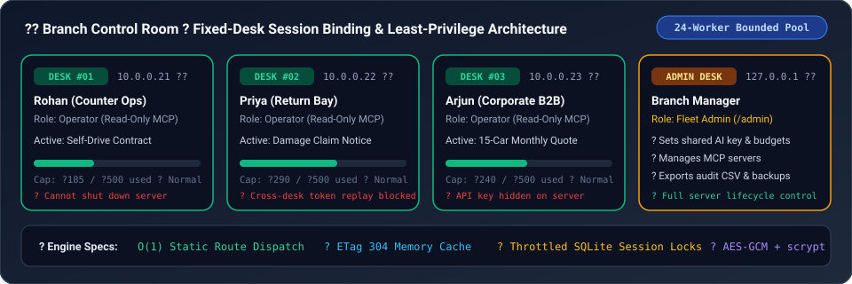

<div align="center">

# 🚘 Float

### **The AI Car Rental Operations & Fleet Command Center**

*Forty cars on the lot. Eight handovers a shift. One of you.*

[](https://github.com/shivasharma12342012-commits/Float/releases/tag/1.0.3)
[](#-📦-download--60-second-quick-start)
[](https://www.python.org/)
[-059669?style=for-the-badge)](#-📦-download--60-second-quick-start)
[](#-🔌-clean-mcp-model-context-protocol-support)
[](#-🧪-testing--verification)

<p align="center">
  <b>Instant GST Rental Quotes</b> • <b>Print-Ready Contracts (DOCX / PDF / XLSX)</b> • <b>Handover & Damage Checklists</b> • <b>Fleet Utilization Analytics</b> • <b>Fixed-Desk Enterprise LAN Server</b>
</p>

<br/>



</div>

---

## 🎮 Interactive Counter Simulator — *Click Any Real Rental Scenario Below*

Want to see exactly how Float handles rush-hour counter chaos? **Click any of the 5 live counter scenarios below** to expand the exact operator prompt, Float's deterministic calculation, and the files it produces in under 3 seconds:

<details open>
<summary><b>🧾 Scenario 1: Outstation SUV Return with Extra Kilometers, FASTag Tolls & Deposit Refund (Click to Toggle)</b></summary>
<br/>

> **🗣️ What your desk operator types:**
> *"Innova Crysta KA-01-AB-4421 returned after 4 days (1,480 km driven, 1,200 km included). Rate is ₹3,500/day, ₹18/extra km, ₹1,400 FASTag tolls, and ₹15,000 security deposit paid. Settle bill with 5% GST and give me a PDF invoice + WhatsApp summary."*

| Line Item | Deterministic Calculation (`calculate_quote`) | Amount (₹) |
| :--- | :--- | ---: |
| **Base Tariff** | `4 days × ₹3,500/day` *(1,200 km free allowance)* | `₹14,000.00` |
| **Extra Distance** | `(1,480 - 1,200) = 280 extra km × ₹18/km` | `₹5,040.00` |
| **FASTag / Highway Tolls** | Actual toll pass-through | `₹1,400.00` |
| **Taxable Subtotal** | Base + Extra KM | `₹19,040.00` |
| **GST (5%)** | `2.5% CGST (₹476.00) + 2.5% SGST (₹476.00)` | `₹952.00` |
| **Total Invoice Value** | Subtotal + Tolls + GST | **`₹21,392.00`** |
| **Security Deposit Adjusted** | Less deposit collected at pickup | `- ₹15,000.00` |
| **💳 Net Payable at Counter** | **Final balance to collect from customer** | **`₹6,392.00`** |

**📦 Instant Deliverables Generated:** `📕 Tax_Invoice_KA01AB4421.pdf` · `📘 Settlement_Receipt.docx` · `💬 One-Click WhatsApp Receipt`

</details>

<details>
<summary><b>🔧 Scenario 2: Bumper Scratch on Return — Damage Deduction vs. Security Deposit Settlement (Click to Expand)</b></summary>
<br/>

> **🗣️ What your return bay agent types:**
> *"Customer returned Hyundai Creta MH-12-PQ-9081 after a 2-day self-drive (₹2,800/day, within km limit). Left rear bumper has a deep scratch (₹2,200 dent/paint + ₹500 workshop labour). Customer paid ₹10,000 deposit. Generate the Damage Claim Notice PDF and calculate the exact refund."*

| Settlement Component | Breakdown | Amount (₹) |
| :--- | :--- | ---: |
| **2-Day Base Rental + 5% GST** | `₹5,600.00 + ₹280.00 GST` | `₹5,880.00` |
| **Assessed Panel Repair** | Rear left bumper repaint (`₹2,200`) + labour (`₹500`) | `₹2,700.00` |
| **Total Charges** | Rental + Damage Claim | `₹8,580.00` |
| **Security Deposit Held** | Paid via UPI at handover | `₹10,000.00` |
| **✅ Net Refund Due to Customer** | **Automatically computed refund balance** | **`₹1,420.00`** |

**📦 Instant Deliverables Generated:** `📕 Damage_Claim_Notice_9081.pdf` *(with panel table & customer acknowledgement signature block)* · `📗 Deposit_Ledger.xlsx`

</details>

<details>
<summary><b>📄 Scenario 3: 60-Second Self-Drive Rental Agreement & Outgoing Handover Sheet (Click to Expand)</b></summary>
<br/>

> **🗣️ What your desk operator types:**
> *"Draft a Self-Drive Rental Agreement and Handover Checklist for Mr. Vikram Nair (DL: KA05-20190088121), vehicle Swift Dzire KA-05-MN-1122, odometer 34,210 km, fuel 6/8 bars, FASTag ₹850, 3 days starting today 10:00 AM, ₹10,000 deposit."*

- **📘 `Rental_Agreement_KA05MN1122.docx` & `.pdf`**:
  - Pre-filled lessee KYC table, vehicle registration, odometer & fuel readings, daily km cap, late-return penalty clauses, prohibited-use terms, and dual signature blocks.
- **📋 `Handover_Checklist_KA05MN1122.pdf`**:
  - Side-by-side **Outgoing vs. Incoming** inspection grid for all 4 doors, bumpers, windshield, tyres, stepney, jack/toolkit, RC/insurance copy, and fuel level.

</details>

<details>
<summary><b>📊 Scenario 4: Upload Monthly Fleet Sheet (`.xlsx` / `.csv`) — Instant Revenue & Utilization Intelligence (Click to Expand)</b></summary>
<br/>

> **🗣️ What the fleet owner does:**
> *Drops `October_Fleet_Bookings.xlsx` into Float and clicks **Fleet & Revenue Analyzer**.*

- **Zero-Dependency Statistical Engine (`float/stats.py`)**:
  - Automatically ranks **Top 5 Highest-Earning Vehicles** vs. **Under-Utilized Idle Cars** on the lot.
  - Computes mean, median, and interquartile revenue per vehicle group (*Hatchback, Compact SUV, 7-Seater MUV, Luxury*).
  - Renders inline **interactive SVG utilization charts** and exports a clean **Management Summary `.xlsx` & `.pdf`** for partner payouts.

</details>

<details>
<summary><b>💰 Interactive ROI Calculator: How Much Time & Money Does Float Save Your Agency? (Click Your Fleet Size)</b></summary>
<br/>

| Your Fleet Size | Daily Handovers & Returns | Time Saved at the Counter | Deposit & Extra-KM Leakage Recovered | Recommended Setup |
| :--- | :--- | :--- | :--- | :--- |
| 🚗 **10 – 20 Cars** *(Single Counter)* | ~6 – 12 / day | **~2.5 hrs / day** *(No manual Word/Excel typing)* | **₹15,000 – ₹30,000 / mo** *(Zero missed extra-km or toll math)* | Single-Desk Mode (`Start Float.bat` / `Float.app`) |
| 🚙 **25 – 60 Cars** *(Busy Branch)* | ~15 – 35 / day | **~6.0 hrs / day** across 3–5 fixed desks | **₹45,000 – ₹90,000 / mo** *(Standardized damage & GST invoices)* | **Branch LAN Server** (`Start Float Agency Server`) |
| 🏢 **75+ Cars** *(Corporate & Airport Hub)* | 50+ / day | **10+ hrs / day** + full audit trail per employee | **₹1,00,000+ / mo** + per-desk rupee budget caps | **Branch LAN Server + Custom MCP (CRM/GPS)** |

</details>

---

## 📦 Download & 60-Second Quick Start

Float requires **only Python 3.10 or newer** and opens in **under 0.3 seconds**. Download the latest pre-packaged release (**[v1.0.3](https://github.com/shivasharma12342012-commits/Float/releases/tag/1.0.3)**) for your operating system:

| Platform | Direct Download | How to Launch |
| :--- | :--- | :--- |
| 🪟 **Windows (x64)** | [**`Float-Windows-x64.zip`**](https://github.com/shivasharma12342012-commits/Float/releases/download/1.0.3/Float-Windows-x64.zip) | Unzip and double-click **`Start Float.bat`** (or **`Start Float.vbs`**). |
| 🍎 **macOS Universal** *(Apple Silicon & Intel)* | [**`Float-macOS-Universal.zip`**](https://github.com/shivasharma12342012-commits/Float/releases/download/1.0.3/Float-macOS-Universal.zip) · [**`.tar.gz`**](https://github.com/shivasharma12342012-commits/Float/releases/download/1.0.3/Float-macOS-Universal.tar.gz) | Unzip and double-click **`Float.app`** (or **`Start Float.command`**). |

<details>
<summary><b>🪟 View All Windows & 🍎 macOS Launchers + CLI Commands (Click to Expand)</b></summary>
<br/>

### 🪟 Windows One-Click Launchers

| Launcher | What It Does |
| :--- | :--- |
| **`Start Float.bat`** / **`Start Float.vbs`** | Starts Float in single-counter mode with instant window launch (`http://127.0.0.1:8766`) and no console clutter. |
| **`Start Float Agency Server.bat`** | Starts Float in **Branch LAN Agency Mode** (`0.0.0.0:8766`) so every fixed desk PC on branch LAN can sign in. |
| **`Stop Float.bat`** / **`Stop Float.vbs`** | Cleanly stops a running Float server in the background. |

### 🍎 macOS (MacBook & Mac) One-Click Launchers

| Launcher | What It Does |
| :--- | :--- |
| **`Float.app`** | Native macOS Application Bundle with Retina icon—double-click in Finder or drag to `/Applications` or Dock for instant launch. |
| **`Start Float.command`** | One-click Finder launcher that automatically clears Gatekeeper quarantine attributes (`xattr -cr`) and starts Float in `< 0.3s`. |
| **`Start Float Agency Server.command`** | Starts Float in **Branch LAN Agency Mode** (`0.0.0.0:8766`) on a central Mac server. |
| **`Stop Float.command`** | Cleanly stops a running Float server and displays a native macOS notification. |

### 💻 Terminal Commands (Windows / macOS / Linux)

```bash
# Start Float locally (opens http://127.0.0.1:8766)
python main.py

# Run as a multi-operator Branch LAN Server
python main.py --lan

# Check if Float is currently running and view its PID / port
python main.py status

# Gracefully stop a running Float server from the terminal
python main.py stop

# Reset an operator's password from the host machine
python main.py set-password operator@agency.local NewStrongPass123!

# Print environment & health diagnostics
python main.py doctor
```

</details>

---

## 🏢 Enterprise Branch LAN Server (Fixed-Desk Security & Least Privilege)

In a real car rental company, employees sit at dedicated desks and shouldn't have administrative power over the server. Float's **Agency Server Mode (`--lan`)** is purpose-built for fixed-desk teams:

<div align="center">
  
</div>

<br/>

- **🔒 Fixed-Desk IP Session Binding**: Each employee's session is cryptographically bound to their desk IP address (`desk_ip`). A session token from Desk #1 (`10.0.0.21`) is immediately rejected if replayed from Desk #2 (`10.0.0.22`), and `/admin` shows every employee's active desk IP live.
- **🛡️ Least-Privilege Employee Controls**: Regular desk operators have zero access to server shutdown, local runtime unlock, raw AI API keys, or MCP server configuration—those controls are strictly locked to `admin` accounts.
- **⚡ Organised High-Speed HTTP Engine**:
  - **Bounded `ThreadPoolExecutor` (24 workers)** prevents thread exhaustion during peak shift handovers.
  - **O(1) Static Route Dispatch & In-Memory `ETag` (`304 Not Modified`) Cache** serves the UI instantaneously across the LAN.
  - **Single-Join Session Resolution** with throttled `last_seen` SQLite writes eliminates database lock contention.

---

## 🛠️ Built-In Agentic Toolkit & MCP

Float's AI assistant never guesses arithmetic—it invokes deterministic local tools to compute bills, inspect fleet groups, and build real downloadable files:

| Tool | Purpose | Key Capabilities |
| :--- | :--- | :--- |
| `calculate_quote` | **Exact Tariff & Settlement Math** | Computes base daily/weekly/monthly rent, included vs. actual km, extra km & extra hour charges, chauffeur allowance, tolls/FASTag, fuel shortage, damage penalties, discounts, CGST/SGST, and net payable or refund due against security deposit. |
| `create_file` | **Native Document Writer** | Builds formatted **Word (`.docx`)**, **Excel (`.xlsx`)**, and **PDF (`.pdf`)** files directly onto your machine with zero third-party libraries. |
| `look_up_class` | **Fleet Group & Roster Lookup** | Retrieves registered vehicle groups, plate numbers, booking histories, and logged revenue/utilization metrics. |
| `save_task` | **Shift Ops Checklist** | Adds dated operational tasks (*Handover*, *Return*, *Maintenance*, *Billing*, *Renewal*, *Follow-up*) directly to the operator's shift queue. |
| `read_my_day` | **Live Shift Dispatch Schedule** | Reads today's upcoming vehicle pickups, returns, and open counter tasks to keep the desk ahead of schedule. |
| `use_computer` | **Operator-Confirmed Desktop Actions** | Optional local screen view and desktop automation on Windows & macOS (strictly restricted to the physical host machine with explicit operator confirmation). |
| `mcp__*` | **Model Context Protocol Tools** | Dynamically discovers and calls tools from any connected `stdio` or `http`/`sse` MCP server. |

---

## 🚘 Tailored for Car Rental Operations

<div align="center">

| 🏷️ Service Modes | 🚙 Fleet Categories | 🌐 13 Supported Languages |
| :--- | :--- | :--- |
| • Self-Drive Daily<br>• Chauffeur-Driven<br>• Corporate / B2B Fleet<br>• Airport & Hotel Transfer<br>• Long-Term Subscription<br>• Luxury & Wedding Fleet | • Hatchback & Compact Sedan<br>• Executive Sedan<br>• Compact SUV<br>• 7-Seater SUV / MUV<br>• Luxury Sedan & Luxury SUV<br>• Electric (EV)<br>• Tempo Traveller / Van / Minibus | • English (`en`) & हिन्दी (`hi`)<br>• বাংলা (`bn`) & मराठी (`mr`)<br>• தமிழ் (`ta`) & తెలుగు (`te`)<br>• ગુજરાતી (`gu`) & ಕನ್ನಡ (`kn`)<br>• മലയാളം (`ml`) & ਪੰਜਾਬੀ (`pa`)<br>• ଓଡ଼ିଆ (`or`), অসমীয়া (`as`), اردو (`ur`) |

</div>

---

## 🤖 Supported AI Providers & Project Structure

<details>
<summary><b>🔌 Supported AI Providers & 📂 Full Repository File Tree (Click to Expand)</b></summary>
<br/>

### Supported AI Providers
Switch providers or models at any time from **Settings** (or branch-wide from **`/admin`**):
- **OpenRouter** *(Claude Sonnet/Haiku, GPT-4o, Gemini, Llama, DeepSeek)*
- **Anthropic** *(Claude Sonnet 4.5, Claude Haiku 4.5, Claude Opus 4.1)*
- **OpenAI** *(GPT-4.1, GPT-4.1 mini, GPT-4o, GPT-4o mini)*
- **Google Gemini** *(Gemini 2.5 Pro, Gemini 2.5 Flash, Gemini 2.0 Flash)*
- **Local Ollama / OpenAI-Compatible Endpoint** *(Run 100% offline on local hardware)*

### Project Structure

```text
Float/
├── main.py                               # CLI entry point (run, --lan, stop, status, doctor, set-password)
├── Float.app/                            # Native macOS Application Bundle (Retina AppIcon.icns + Info.plist)
├── Start Float.command                   # One-click macOS Finder launcher (< 0.3s startup)
├── Start Float Agency Server.command     # One-click macOS branch LAN server launcher
├── Stop Float.command                    # One-click macOS server stopper
├── Start Float.bat / Start Float.vbs     # One-click Windows local desk launchers
├── Start Float Agency Server.bat         # One-click Windows branch LAN server launcher
├── Stop Float.bat / Stop Float.vbs       # One-click Windows server stoppers
├── float/
│   ├── agent.py                          # System prompt, car rental persona & streaming tool loop
│   ├── artifacts.py                      # Zero-dependency .docx, .xlsx, and .pdf document writers
│   ├── attachments.py                    # PDF, Word, Excel, and CSV text extraction for uploads
│   ├── computer.py                       # Operator-confirmed local screen & desktop automation (Windows & macOS)
│   ├── config.py                         # Providers, fleet categories, service modes & environment settings
│   ├── db.py                             # SQLite schema, desk IP session binding, fleet groups, tasks & audit log
│   ├── desktop.py                        # Cross-platform window & control discovery (Win32 / UIA / AppleScript)
│   ├── greeting.py                       # Shift-aware operator greeting & upcoming pickup/return alerts
│   ├── mcp.py                            # Clean Model Context Protocol client (stdio & HTTP JSON-RPC)
│   ├── providers.py                      # Streaming LLM adapters (Anthropic, OpenAI, Gemini, OpenRouter)
│   ├── security.py                       # scrypt password hashing, rate limiting & at-rest secret encryption
│   ├── server.py                         # Bounded thread-pool HTTP/TLS server, ETag cache & REST/SSE routes
│   ├── stats.py                          # Pure-Python fleet/revenue sheet statistics & analysis
│   ├── tools.py                          # Native rental quote engine, document builder & tool dispatcher
│   └── web/                              # Smooth, autofill-free vanilla JS/CSS counter workspace & Admin UI
├── docs/
│   ├── assets/                           # Animated SVG counter demo & branch control room visuals
│   ├── DESIGN.md                         # Architecture & zero-dependency engineering notes
│   └── AGENCY_SERVER.md                  # Branch LAN deployment & administration guide
└── tests/                                # 481 unit & integration tests
```

</details>

---

## 🧪 Testing & Verification

Run the complete **481-test suite** (covering quote arithmetic, GST/deposit edge cases, document generation, XLSX parsing, MCP clients, fixed-desk LAN session binding, least-privilege controls, macOS bundle integrity, and server stop lifecycle) with warnings treated as errors:

```bash
python -W error -m unittest discover -s tests -p "*.py"
```

---

<div align="center">

**Built for Car Rental Desks & Fleet Operations Teams on Windows & macOS — Fast, Local-First, Zero Dependencies.**

</div>
