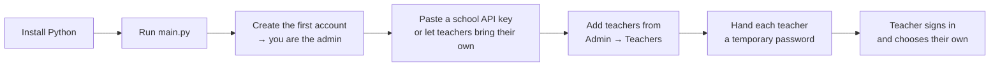
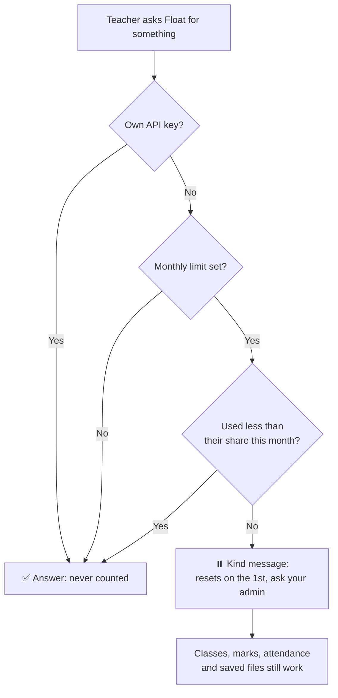

<div align="center">


# Float

### Your teaching, lighter.

*A working companion for schoolteachers: the paperwork gets faster, the teaching stays yours.*

<br>


<br>

[**Get started**](#-getting-started) &nbsp;·&nbsp;
[**Toolkit**](#-the-toolkit) &nbsp;·&nbsp;
[**Admin panel**](#-the-admin-panel) &nbsp;·&nbsp;
[**Fairness & privacy**](#-fairness-and-privacy-by-design) &nbsp;·&nbsp;
[**Testing**](#-how-float-was-tested)

</div>

---

Float is not a school portal, and it isn't trying to run your school. It is built around **one teacher at a time**: the six periods, the hundred and twenty exercise books, the parent messages that all need to sound a little different, the report card remarks due Friday.

It drafts the paperwork, keeps your classes straight, and, if you let it, can even move the mouse for the tedious on-screen parts of a task. Everything runs on your own computer. There is no Float server anywhere collecting anything.

<br>

## 📑 Contents

| | |
|---|---|
| 🌱 [Why Float exists](#-why-float-exists) | 🧰 [The toolkit](#-the-toolkit) |
| 🚀 [Getting started](#-getting-started) | 🏫 [Classes, marks and your day](#-classes-marks-and-your-day) |
| 🔑 [Choosing a model](#-choosing-a-model) | 🎚️ [How much Float does for you](#️-how-much-float-does-for-you) |
| 📂 [Files, Drive and Desktop](#-files-drive-and-desktop) | 🛡️ [The admin panel](#️-the-admin-panel) |
| ⚖️ [Fairness and privacy by design](#️-fairness-and-privacy-by-design) | 🔒 [Security](#-security) |
| 🧪 [How Float was tested](#-how-float-was-tested) | 🗂️ [Project layout](#️-project-layout) |
| 🪟 [Running it on Windows](#-running-it-on-windows) | 🩺 [Troubleshooting](#-troubleshooting) |
| 🗺️ [Known limits and what's next](#️-known-limits-and-whats-next) | 📜 [License](#-license) |

<br>

## 🌱 Why Float exists

Most classroom software is built for the institution: attendance systems, gradebooks, timetabling engines. Float is built for the person standing at the board. It doesn't ask which vendor your school has a contract with, doesn't need an IT rollout, and doesn't put anyone above you except the one admin your own school chooses.

It also tries hard **not to make you worse at your job**. An assistant that quietly does all your thinking isn't really helping, so Float defaults to a **first draft that clearly wants your read-through**, not a finished product you'd never think to check.

> **The three promises**
>
> 🧑‍🏫 **It's yours.** Every screen is scoped to one teacher's own classes, drafts and files.
> ⚖️ **It's fair.** Every teacher gets the same share of the school's AI budget. Exceptions are visible and explained.
> 🔐 **It's private.** The admin manages *accounts*, never *content*. There is no screen or API for reading what a teacher wrote.

<br>

## 🚀 Getting started

You need **Windows** and **Python 3.10 or later**. Nothing else is required, because Float runs entirely on the standard library.

```bash
git clone https://github.com/shivasharma12342012-commits/Float.git
cd Float
pip install -r requirements.txt   # optional, see below
python main.py
```

A browser tab opens at `http://127.0.0.1:8765`. **The first account you create becomes your school's admin.** After that, the admin adds every teacher (self sign-up is off by default).

> 💡 Once it's set up you can skip the terminal entirely. Double-click [`Start Float.vbs`](#-running-it-on-windows) for a launcher with no console window.

### The first ten minutes



### What the optional packages buy you

| Package | Without it | With it |
|---|---|---|
| `cryptography` | API keys are still encrypted, with a standard-library fallback | Encrypted with **AES-256-GCM** instead *(strongly recommended)* |
| `pyautogui` | Everything else works normally | Float can move the mouse and type: the "use my computer" tool |
| `keyboard` | The stop button still works | Pressing **Esc** interrupts a running "use my computer" task |
| `pyperclip` | Only characters that are real keys can be typed | Hindi and other Indian-script text types correctly in "use my computer" tasks |
| `pypdf` | Only simple text PDFs can be attached | Float can read text out of PDFs such as an NCERT chapter |

Skip any of them freely. Nothing else in Float depends on them.

### Where your data lives

Everything Float needs sits in a `data/` folder next to `main.py`:

```
data/
├── float.sqlite3      accounts, classes, conversations, tasks, usage, audit log
└── files/             documents Float has made, until you save them elsewhere
```

Delete `data/` at any point to start completely fresh.

<br>

## 🧰 The toolkit

**Nineteen** ready-made workflows, each a short form that turns into a real first draft: a Word document, a PDF, or a spreadsheet, depending on what makes sense.

<table>
<tr>
<td valign="top" width="25%">

**📐 Planning**
- Lesson plan
- Syllabus pacing
- Seating and groups

**🎓 Teaching**
- Explain in two languages
- Classroom activity
- Remedial plan
- Lesson slides
- Solve a doubt

</td>
<td valign="top" width="25%">

**📝 Assessment**
- Question paper
- Worksheet
- Mark an answer
- Rubric

**📊 Reporting**
- Report card remarks
- Marks analysis
- Holistic progress descriptors

</td>
<td valign="top" width="25%">

**💬 Communication**
- Message to a parent
- Notice or circular
- Letter to the principal
- Assembly speech

</td>
<td valign="top" width="25%">

**🇮🇳 Built in**
- CBSE, ICSE, state boards, IB, Cambridge
- Blueprints and marking schemes that add up
- Parent messages in **13 Indian languages**
- Activities for 50 students and no budget

</td>
</tr>
</table>

<br>

## 🏫 Classes, marks and your day

Float keeps the small records a teacher touches every day, **scoped to you and nobody else**.

| You can | How it behaves |
|---|---|
| **Create a class** | Give it a name (`8B`), grade, section, subject and board. |
| **Paste a roster** | Paste a list straight from a register or WhatsApp. Numbered lines (`1,` or `2.`), blank lines, Hindi names such as आर्यन गुप्ता, and names like `Mohd.` or `D'Souza` all import cleanly. |
| **Save marks** | Scores are checked: negative marks, a score above the maximum, and a maximum of zero are refused with a friendly message. Marks for a student who isn't in the class are refused too. |
| **Take attendance** | Mark who is absent, once, in a single step. |
| **Keep tasks** | A simple to-do list with due dates, such as "Check UT-1 copies". |
| **Set a timetable** | Your periods feed the greeting when you open Float. |

A teacher can never see, change or delete another teacher's classes, marks, tasks or chats. Attempts get a plain *"No such class."* and nothing is touched.

<br>

## 🔑 Choosing a model

Float doesn't ship with a model of its own. Open **Settings → Model & keys** and paste in a key from whichever provider you already use.

| Provider | Fast, cheap default | Best available | Get a key |
|---|---|---|---|
| **Anthropic** | Claude Sonnet 4.5 | Claude Opus 4.1 | [console.anthropic.com](https://console.anthropic.com/settings/keys) |
| **OpenAI** | GPT-4.1 mini | GPT-4.1 | [platform.openai.com](https://platform.openai.com/api-keys) |
| **Google** | Gemini 2.0 Flash | Gemini 2.5 Pro | [aistudio.google.com](https://aistudio.google.com/app/apikey) |

*Approximate cost per million tokens is shown in Settings and on the admin dashboard. Check each provider's own pricing page for the current rate.*

### Two ways to pay

| | **School key** | **Your own key** |
|---|---|---|
| Who pays | The school | You, directly to the provider |
| Set by | The admin (**School settings**) | The teacher (**Settings → Model & keys**), if the admin allows it |
| Counts toward your monthly share | **Yes** | **No, never** |

<br>

## 🎚️ How much Float does for you

Under **Settings → How Float helps**, three levels change how Float actually behaves. This is not just a label: it changes the instructions Float works from.

| Level | What happens |
|---|---|
| 🧭 **Coach me** | Float asks questions and reacts to what you write. You do the writing. |
| ✍️ **Draft it** *(default)* | Float writes a first version and says plainly where it guessed, so you know what to check. |
| ⚡ **Do it all** | Float finishes routine paperwork outright, useful for notices, seating charts and mark sheets. |

Once a week, Float also shows roughly how much of what went out was in your own words versus drafted for you. It isn't there to police you, but because a teacher who edits everything usually teaches better than one who forwards it unread.

<br>

## 📂 Files, Drive and Desktop

When Float makes something, it appears as a file card with three choices: **Desktop**, **Drive**, **Download**. Nothing saves anywhere on its own. You decide where it goes, every time.

<br>

## 🛡️ The admin panel

Visit **`/admin`**, or use the shield icon in the sidebar if your account is an admin. Six tabs, built for a head of department rather than an IT department:

| Tab | What it's for |
|---|---|
| 📈 **Overview** | School-wide totals: teachers, who is signed in, answers and tokens in the last 30 days, estimated spend, and a 14-day activity chart. |
| 👩‍🏫 **Teachers** | Add a teacher (Float generates a temporary password), reset a password, sign someone out, make an admin or teacher, **adjust a monthly limit**, deactivate, reactivate, or delete. |
| ⚖️ **Fairness & privacy** | The equal monthly share, the school budget, what the admin can see about each teacher, and a plain statement of what the admin cannot see. |
| 🏫 **School settings** | School name, which AI providers are allowed, the school-wide key, whether teachers may add their own key, self sign-up, quick-PIN, and the "use the computer" switch. |
| 📣 **Notices** | A message that appears for every teacher, which you can retire later. |
| 🧾 **Audit log** | Who did what and when: sign-ins, resets, role changes, limit exceptions, exports. |

There is also a one-click **usage report** (Excel). It contains **no email addresses**, follows your privacy setting, and each download is written to the audit log.

<br>

## ⚖️ Fairness and privacy by design

Float's admin panel exists to **manage accounts and share a budget fairly**. It deliberately cannot become a way to watch teachers.

### Equality: an equal share, with honest exceptions



- **One equal limit for everyone.** Set a monthly rupee amount per teacher in **Fairness & privacy**. `0` means no limit.
- **Exceptions need a reason.** A head of department who writes papers for four classes, or a teacher with accessibility needs, can be given a different limit from the Teachers tab. Float **refuses the change without a written reason**, and the reason is recorded in the audit log, so exceptions stay visible and fair.
- **One teacher's use never blocks another.** Limits are per person. The school-wide budget is a **warning only** and never cuts anyone off.
- **Teachers see their own share.** In **Settings**, each teacher sees *"Your share this month: ₹X of ₹Y"* with a progress bar, a gentle heads-up at 80%, and a reminder that their own API key is never counted. Nobody sees anyone else's.
- **Nobody is locked out of their work.** Even at the limit, classes, marks, attendance, tasks and saved files keep working.
- **Fairness is measured without naming people.** The panel shows how many teachers haven't started yet, how concentrated spending is (the top fifth's share), and how many are near their limit, all as school-wide numbers.

> 🌿 **Why "yet to start" is shown as a number, not a list.** A teacher who hasn't tried Float usually needs a short walkthrough, not a nudge from the principal. The panel is built to suggest that.

### Privacy: what the admin can and cannot see

| ✅ The admin **can** see | ❌ The admin **cannot** see, at all |
|---|---|
| Account names, emails and roles | Any chat, draft or generated file |
| Sign-in counts | Class lists, student names, marks or attendance |
| Usage as a **band** (No use / Light / Regular / Frequent) | Anything a teacher typed |
| School-wide totals and estimated spend | *There is no screen or API route that returns these.* |

- **Bands by default.** Exact per-teacher counts and rupees are hidden unless the admin deliberately switches to *Exact counts and ₹*.
- **No rankings, ever.** Teachers are listed alphabetically, never by spend.
- **Everything sensitive is logged:** limit changes (with the reason), exports, password resets, role changes and school-setting changes.

<br>

## 🔒 Security

| Protection | How it works |
|---|---|
| **Sessions end when you close the app** | A fresh random key is generated every time Float starts and mixed into every session token. Restarting invalidates every open session. |
| **No cookies, no CSRF surface** | The session token lives in the browser tab's memory and travels as a bearer token. There is nothing for a cross-site request to ride on. |
| **Strong passwords only** | Weak choices such as `12345678` and `password` are refused. Passwords are hashed with scrypt. |
| **Guess-proof sign-in** | Repeated wrong passwords are rate-limited. |
| **Temporary passwords** | A teacher added by the admin must choose their own password on first sign-in. |
| **Instant lock-out** | Deactivating a teacher ends their sessions immediately. |
| **API keys encrypted at rest** | Using a device-specific key that never leaves your machine. |
| **Teachers are isolated** | Every query is scoped to the signed-in teacher. Admin routes return `403` to non-admins. |
| **Your files, your call** | Nothing is written to Drive or the Desktop unless you press the button. |
| **Hardened web server** | Standard security headers, and path-traversal URLs return `404`. |

<br>

## 🧪 How Float was tested

Float has been tested like a real school would use it: an AI-assisted script played a **principal**, a **Class 8B Maths teacher** and a **second teacher**, step by step.

| Measure | Result |
|---|---|
| Unit tests | **33 / 33 pass** |
| Live teacher + admin + security + speed checks | **65 / 65 pass** |
| Server errors during the run | **0** |
| Load: 300 requests from 30 simultaneous users | **0 errors**, slowest request under 2 seconds |
| Another teacher reading, editing or deleting your data | **Refused every time** |

<details>
<summary><strong>What the live tests covered</strong></summary>
<br>

| Area | Examples |
|---|---|
| **Setup** | First account becomes admin; weak passwords refused; strangers can't self-sign-up |
| **Admin** | Adding teachers; duplicate emails refused; invalid settings refused |
| **Teacher's day** | Temporary password then own password; email typed in capitals with a space; 45-name roster with Hindi names; bad marks refused; attendance; tasks; timetable |
| **AI chat** | A calm message when no API key is set |
| **Privacy** | Teacher-to-teacher isolation; admin routes blocked for teachers; forged and missing tokens refused; no content in the admin payload; export has no emails and is logged |
| **Equity** | Equal limit enforced kindly; an under-limit teacher is unaffected; limit exception refused without a reason, accepted with one; reason visible in the audit log |
| **Security** | Sign-in rate limiting; sessions dead after sign-out; deactivated teachers kicked out; 3 MB input; SQL-style input |
| **Speed** | 30 parallel users, 300 requests |

</details>

Full write-ups, including bugs found and fixed, are in the repository: `Float Test Report 4.md` (marks and maths) and `Float Test Report 5.md` (average-teacher run and the admin panel).

> **Honest note.** Tests ran with no AI key, so real AI answers (worksheet quality, true spend against the limit) were not part of them. See [Known limits](#️-known-limits-and-whats-next).

To run the unit tests yourself:

```bash
python -m unittest tests.test_float
```

<br>

## 🗂️ Project layout

```
Float/
├── main.py                 CLI entry point: start here
├── requirements.txt
├── Start Float.bat         double-click launcher (shows messages)
├── Start Float.vbs         double-click launcher (no console window)
├── float/
│   ├── config.py           providers, models, Indian-schools context
│   ├── security.py         password hashing, session tokens, encryption, rate limits
│   ├── db.py               SQLite schema and every query, including fair-share limits
│   ├── providers.py        streaming client for each AI provider
│   ├── artifacts.py        builds real .docx / .pdf / .xlsx files, zero dependencies
│   ├── attachments.py      reads files you attach in chat
│   ├── computer.py         mouse and keyboard control, with an on-screen indicator
│   ├── greeting.py         the opening screen
│   ├── tools.py            the 19-entry toolkit and the tool-calling system prompt
│   ├── agent.py            the conversation loop
│   ├── google.py           OAuth sign-in and Drive upload
│   ├── server.py           the HTTP server and every API route
│   └── web/
│       ├── index.html, app.js, app.css     the teacher's app
│       ├── login.html, login.js            sign-in
│       └── admin.html, admin.js            the admin panel
├── docs/DESIGN.md          the reasoning behind the design and security choices
├── tests/test_float.py     the test suite
├── Float Test Report*.md   test write-ups
└── Float License           licence terms
```

<br>

## 🪟 Running it on Windows

Float is built for and supported on **Windows**.

| You want | Do this |
|---|---|
| **Open Float with no black window** | Double-click **`Start Float.vbs`**. |
| **An icon on your desktop** | Right-click `Start Float.vbs` → *Create shortcut*, then drag it out. |
| **Pin it to the taskbar** | Right-click the shortcut → *Pin to taskbar*. |
| **Start Float when you log in** | Press `Win + R`, type `shell:startup`, and drop the shortcut in the folder. |
| **See error messages** | Run **`Start Float.bat`** instead. It shows its output. |
| **Use a different port** | `python main.py --port 9000` |
| **Close Float** | Close its window, or press `Ctrl + C`. Everyone is signed out. |

> Float is built for and tested on Windows. The server and tests also run on Linux (the file-name case problem that used to stop it is fixed and guarded by a test), but the launchers, window mode and "use my computer" tool have only been checked on Windows.

<br>

## 🩺 Troubleshooting

<details>
<summary><strong>Float says the address is already in use</strong></summary>
<br>

It's probably already running. Check for an existing browser tab first. If not, something else is using port 8765, so start Float on a different one:

```bash
python main.py --port 9000
```
</details>

<details>
<summary><strong>I forgot my password</strong></summary>
<br>

Ask your school's admin to reset it from **Admin → Teachers**, or run this from a terminal in the project folder:

```bash
python main.py set-password you@school.edu.in
```
</details>

<details>
<summary><strong>I forgot the admin password, or I need to promote someone to admin</strong></summary>
<br>

From a terminal in the project folder:

```bash
python main.py set-password admin@school.edu.in
python main.py make-admin teacher@school.edu.in
```
</details>

<details>
<summary><strong>Float says I've used my share of the school's AI budget</strong></summary>
<br>

Every teacher gets an equal monthly allowance, and it resets on the 1st. Your classes, marks, attendance and saved files all still work. Ask your admin to adjust your limit if you have a heavy month (they'll note a reason), or add your own API key under **Settings → Model & keys**, which is never counted against the school's share.
</details>

<details>
<summary><strong>Nothing happens when I double-click the launcher</strong></summary>
<br>

Run `Start Float.bat` directly instead of the `.vbs` shortcut. That one shows its output, so you can read the actual error. It's almost always Python not being installed, or not added to `PATH` during setup.
</details>

<details>
<summary><strong>Float won't answer: "no key"</strong></summary>
<br>

Float needs an API key from Anthropic, OpenAI or Google. Ask your admin whether the school has a shared key, or add your own under **Settings → Model & keys**.
</details>

<details>
<summary><strong>Can the principal read my chats or see my students' marks?</strong></summary>
<br>

No. The admin panel has no screen and no route that returns chats, drafts, files, class lists, marks or attendance. The admin sees account details and a usage *band*, and every sensitive admin action is written to the audit log.
</details>

<br>

## 🗺️ Known limits and what's next

**Be aware of**

- **The monthly limit uses estimates.** Spend is calculated from published per-token prices, so it is a fair-share guide, not an invoice. Your provider's bill is the real number.
- **Real-AI behaviour at the limit** was tested with simulated usage rather than live spending.
- **Windows only.** Launchers, tray behaviour and the "use my computer" tool are built for Windows.
- **Google sign-in, PIN sign-in and the Windows launchers** have not yet been through a written test report.

**Ideas on the shelf**

- A short, in-app walkthrough for teachers who haven't started yet
- Per-subject or per-department allowances
- A printable one-page "staff room guide" for new teachers

<br>

## 📜 License

**Float is proprietary software.** Copyright © 2026 Shiva Sharma, Prabhjot Singh and Yatharth Joshi. All rights reserved.

Licensed to **New Era Public School** under a separate written agreement. Nothing in this repository grants any right to copy, modify, host, redistribute or resell Float without a written agreement signed by all three authors. The full terms are in [`Float License`](Float%20License).

| | |
|---|---|
| **Owners** | Shiva Sharma, Prabhjot Singh, Yatharth Joshi |
| **Licensee** | New Era Public School |
| **Data** | Stays on the school's own computers; the authors hold none of it |
| **Third-party packages** | Optional (`cryptography`, `pyautogui`, `keyboard`, `pyperclip`, `pypdf`), each under its own licence |

For licensing, support or purchase enquiries, contact the authors at **[your email]**.

<br>

<div align="center">

---

**Float** · *Your teaching, lighter.*

Made for the teacher at the board, not the office above them.

</div>
