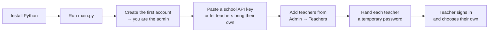
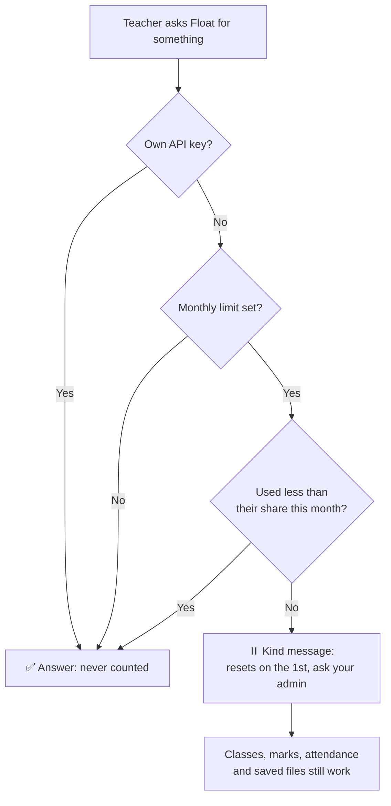

<div align="center">


# Float

### Your teaching, lighter.

*Some tools ask for your attention. Float gives it back.*

<br>


<br>

[**Get started**](#-getting-started) &nbsp;·&nbsp;
[**Toolkit**](#-the-toolkit) &nbsp;·&nbsp;
[**Admin panel**](#-the-admin-panel) &nbsp;·&nbsp;
[**Fairness & privacy**](#-fairness-and-privacy-by-design) &nbsp;·&nbsp;
[**Testing**](#-how-float-was-tested)

</div>

---

> *It is seven in the morning. The staff room is quiet, the kettle has just clicked off, and there is a stack of exercise books waiting beside a half-written question paper.*
>
> *This is the moment Float was made for.*

Float is a calm, capable companion for the person at the front of the classroom. It takes on the paperwork that crowds a teacher's evenings (the lesson plans, the report card remarks, the notice that has to go out today) and hands it back as a first draft you can shape in minutes.

It never tries to run your school, and it never tries to replace your judgement. The teaching stays yours, and so does the voice, the decisions and the relationship with every child in the room. Float simply clears the desk so you have room for all of that.

Everything happens on your own computer. There is no Float server collecting anything, and nobody is quietly watching from above.

<br>

## 📑 Contents

| | |
|---|---|
| 🌱 [Why Float exists](#-why-float-exists) | 🧰 [The toolkit](#-the-toolkit) |
| 🚀 [Getting started](#-getting-started) | 🏫 [Classes, marks and your day](#-classes-marks-and-your-day) |
| 🔑 [Choosing a model](#-choosing-a-model) | 🎚️ [How much Float does for you](#️-how-much-float-does-for-you) |
| 📂 [Files, Drive and Desktop](#-files-drive-and-desktop) | 🛡️ [The admin panel](#️-the-admin-panel) |
| ⚖️ [Fairness and privacy by design](#️-fairness-and-privacy-by-design) | 🔒 [Security](#-security) |
| 🏫 [One server for the whole school](#-one-server-for-the-whole-school) | 💾 [Backups and restoring](#-backups-and-restoring-your-data) |
| 🧪 [How Float was tested](#-how-float-was-tested) | 🗂️ [Project layout](#️-project-layout) |
| 🪟 [Running it on Windows](#-running-it-on-windows) | 🩺 [Troubleshooting](#-troubleshooting) |
| 🗺️ [Known limits and what's next](#️-known-limits-and-whats-next) | 📜 [License](#-license) |

<br>

## 🌱 Why Float exists

Most classroom software is built for the institution: attendance systems, gradebooks, timetabling engines. Float is built for the person standing at the board, with eight periods in the day, forty-odd faces in every room, and a hundred and twenty books to get through before the weekend.

It doesn't ask which vendor your school has a contract with. It doesn't need an IT rollout. It doesn't place anyone above you except the one admin your own school chooses.

Float also takes care **not to make you worse at your job**. An assistant that quietly does all your thinking is not really helping, so Float begins with a **first draft that invites your read-through** rather than a finished page you would never think to check. The goal is a teacher who is rested and still entirely in charge.

> **Three promises**
>
> 🧑‍🏫 **It's yours.** Every screen belongs to one teacher: their classes, their drafts, their files.
> ⚖️ **It's fair.** Every teacher receives the same share of the school's AI budget, and every exception is visible and explained.
> 🔐 **It's private.** The admin manages *accounts*, never *content*. There is no screen and no route for reading what a teacher has written.

<br>

## 🚀 Getting started

You need **Windows** and **Python 3.10 or later**. Nothing else is required, because Float runs entirely on the Python standard library.

```bash
git clone https://github.com/shivasharma12342012-commits/Float.git
cd Float
pip install -r requirements.txt   # optional, see below
python main.py
```

A browser tab opens at `http://127.0.0.1:8766`, and a short opening screen with the Float logo welcomes you in. **The first account you create becomes your school's admin.** After that, the admin adds every teacher (self sign-up is off by default).

> 💡 Once Float is set up, you can leave the terminal behind. Double-click [`Start Float.vbs`](#-running-it-on-windows) to open it with no console window.

### The first ten minutes



### What the optional packages add

| Package | Without it | With it |
|---|---|---|
| `cryptography` | API keys are still encrypted, using a standard-library fallback | Encrypted with **AES-256-GCM** instead *(strongly recommended)* |
| `pyautogui` | Everything else works as normal | Float can move the mouse and type: the "use my computer" tool |
| `keyboard` | The stop button still works | Pressing **Esc** interrupts a running "use my computer" task |
| `pyperclip` | Only characters that are real keys can be typed | Hindi and other Indian-script text types correctly in "use my computer" tasks |
| `pywinauto` | Float relies on screen position to find controls | Float finds buttons and search boxes by name in Windows apps and browsers *(recommended on Windows)* |
| `Pillow` | Float works without seeing the screen | Float can take a screenshot with numbered controls so it can see what it is doing |
| `pypdf` | Only simple text PDFs can be attached | Float can read text from PDFs such as an NCERT chapter |

Skip any of them freely. Nothing else in Float depends on them.

### Where your data lives

Everything Float needs sits in a `data/` folder beside `main.py`:

```
data/
├── float.sqlite3      accounts, classes, conversations, tasks, usage, audit log
├── backups/           automatic daily copies of the database
├── files/             documents Float has made, until you save them elsewhere
└── float_errors.log   a plain record of anything that went wrong
```

Delete `data/` at any point to begin completely fresh.

<br>

## 🧰 The toolkit

**Nineteen** ready-made workflows. Each is a short form that becomes a real first draft: a Word document, a PDF or a spreadsheet, whichever suits the task.

<table>
<tr>
<td valign="top" width="25%">

**📐 Planning**
- Lesson plan
- Syllabus pacing
- Seating and groups

**🎓 Teaching**
- Explain in two languages
- Classroom activity
- Remedial plan
- Lesson slides
- Solve a doubt

</td>
<td valign="top" width="25%">

**📝 Assessment**
- Question paper
- Worksheet
- Mark an answer
- Rubric

**📊 Reporting**
- Report card remarks
- Marks analysis
- Holistic progress descriptors

</td>
<td valign="top" width="25%">

**💬 Communication**
- Message to a parent
- Notice or circular
- Letter to the principal
- Assembly speech

</td>
<td valign="top" width="25%">

**🇮🇳 Built for Indian classrooms**
- CBSE, ICSE, state boards, IB, Cambridge
- Blueprints and marking schemes that add up
- Parent messages in **13 Indian languages**
- Activities for 50 students and no budget

</td>
</tr>
</table>

<br>

## 🏫 Classes, marks and your day

Float keeps the small records a teacher touches every day, **scoped to you and nobody else**.

| You can | How it behaves |
|---|---|
| **Create a class** | Give it a name (`8B`), grade, section, subject and board. |
| **Paste a roster** | Paste a list straight from a register or WhatsApp. Numbered lines (`1,` or `2.`), blank lines, Hindi names such as आर्यन गुप्ता, and names like `Mohd.` or `D'Souza` all import cleanly. |
| **Save marks** | Scores are checked. Negative marks, a score above the maximum and a maximum of zero are refused with a friendly message, and so are marks for a student who isn't in the class. |
| **Take attendance** | Mark who is absent, once, in a single step. |
| **Keep tasks** | A simple to-do list with due dates, such as "Check UT-1 copies". |
| **Set a timetable** | Your periods shape the greeting you see when you open Float. |

A teacher can never see, change or delete another teacher's classes, marks, tasks or chats. Any attempt receives a plain *"No such class."* and nothing is touched.

<br>

## 🔑 Choosing a model

Float doesn't ship with a model of its own. Open **Settings → Model & keys** and paste in a key from whichever provider you already use.

| Provider | Fast, economical default | Best available | Get a key |
|---|---|---|---|
| **Anthropic** | Claude Sonnet 4.5 | Claude Opus 4.1 | [console.anthropic.com](https://console.anthropic.com/settings/keys) |
| **OpenAI** | GPT-4.1 mini | GPT-4.1 | [platform.openai.com](https://platform.openai.com/api-keys) |
| **Google** | Gemini 2.0 Flash | Gemini 2.5 Pro | [aistudio.google.com](https://aistudio.google.com/app/apikey) |

*Approximate cost per million tokens is shown in Settings and on the admin dashboard. Please check each provider's own pricing page for the current rate.*

### Two ways to pay

| | **School key** | **Your own key** |
|---|---|---|
| Who pays | The school | You, directly to the provider |
| Set by | The admin (**School settings**) | The teacher (**Settings → Model & keys**), if the admin allows it |
| Counts toward your monthly share | **Yes** | **No, never** |

<br>

## 🎚️ How much Float does for you

Under **Settings → How Float helps**, three levels change how Float actually behaves. This is more than a label, because each level changes the instructions Float works from.

| Level | What happens |
|---|---|
| 🧭 **Coach me** | Float asks questions and responds to what you write. You do the writing. |
| ✍️ **Draft it** *(default)* | Float writes a first version and says plainly where it guessed, so you know exactly what to check. |
| ⚡ **Do it all** | Float finishes routine paperwork outright, which suits notices, seating charts and mark sheets. |

Once a week, Float also shows roughly how much of what went out was in your own words and how much was drafted for you. It is not there to police anyone. It is there because a teacher who shapes every draft usually teaches better than one who forwards it unread.

<br>

## 📂 Files, Drive and Desktop

When Float makes something, it appears as a file card with three choices: **Desktop**, **Drive** and **Download**. Nothing is saved anywhere on its own, and you decide where each file goes, every time.

<br>

## 🛡️ The admin panel

Visit **`/admin`**, or use the shield icon in the sidebar if your account is an admin. There are six tabs, built for a head of department rather than an IT department.

| Tab | What it's for |
|---|---|
| 📈 **Overview** | School-wide totals: teachers, who is signed in, answers and tokens in the last 30 days, estimated spend, a 14-day activity chart, and the time of the last backup (with a **Back up now** button). |
| 👩‍🏫 **Teachers** | Add a teacher (Float generates a temporary password), reset a password, sign someone out, make someone an admin or teacher, **adjust a monthly limit**, deactivate, reactivate or delete. |
| ⚖️ **Fairness & privacy** | The equal monthly share, the school budget, what the admin can see about each teacher, and a plain statement of what the admin cannot see. |
| 🏫 **School settings** | School name, which AI providers are allowed, the school-wide key, whether teachers may add their own key, self sign-up, quick-PIN, and the "use the computer" switch. |
| 📣 **Notices** | A message that appears for every teacher, which you can retire later. |
| 🧾 **Audit log** | Who did what and when: sign-ins, resets, role changes, limit exceptions and exports. |

There is also a one-click **usage report** (Excel). It contains **no email addresses**, follows your privacy setting, and every download is written to the audit log.

<br>

## ⚖️ Fairness and privacy by design

The admin panel exists to **manage accounts and share a budget fairly**. It was deliberately designed so that it can never become a way to watch teachers.

### Equality: an equal share, with honest exceptions



- **One equal limit for everyone.** Set a monthly rupee amount per teacher in **Fairness & privacy**. `0` means no limit.
- **Exceptions need a reason.** A head of department who writes papers for four classes, or a teacher with accessibility needs, can be given a different limit from the Teachers tab. Float **declines the change without a written reason**, and the reason is recorded in the audit log, so exceptions stay visible and fair.
- **One teacher's use never blocks another's.** Limits are per person. The school-wide budget is a **warning only** and never cuts anyone off.
- **Teachers see their own share.** In **Settings**, each teacher sees *"Your share this month: ₹X of ₹Y"* with a progress bar, a gentle heads-up at 80%, and a reminder that their own API key is never counted. Nobody sees anyone else's.
- **Nobody is locked out of their work.** Even at the limit, classes, marks, attendance, tasks and saved files keep working.
- **Fairness is measured without naming people.** The panel shows how many teachers haven't started yet, how concentrated spending is (the top fifth's share) and how many are near their limit, all as school-wide numbers.

> 🌿 **Why "yet to start" is a number and not a list.** A teacher who hasn't tried Float usually needs a short walkthrough, not a nudge from the principal. The panel is designed to point toward the walkthrough.

### Privacy: what the admin can and cannot see

| ✅ The admin **can** see | ❌ The admin **cannot** see, at all |
|---|---|
| Account names, emails and roles | Any chat, draft or generated file |
| Sign-in counts | Class lists, student names, marks or attendance |
| Usage as a **band** (No use / Light / Regular / Frequent) | Anything a teacher typed |
| School-wide totals and estimated spend | *There is no screen or API route that returns these.* |

- **Bands by default.** Exact per-teacher counts and rupees stay hidden unless the admin deliberately switches to *Exact counts and ₹*.
- **No rankings, ever.** Teachers are listed alphabetically, never by spend.
- **Everything sensitive is logged:** limit changes (with the reason), exports, password resets, role changes and school-setting changes.

<br>

## 🔒 Security

| Protection | How it works |
|---|---|
| **Sessions end when you close the app** | A fresh random key is generated every time Float starts and mixed into every session token. Restarting invalidates every open session. |
| **No cookies, no CSRF surface** | The session token lives in the browser tab's memory and travels as a bearer token, never in a URL. There is nothing for a cross-site request to ride on. |
| **Strong passwords only** | Weak choices such as `12345678` and `password` are refused. Passwords are hashed with scrypt. |
| **Guess-proof sign-in** | Repeated wrong passwords are rate-limited. |
| **Temporary passwords** | A teacher added by the admin must choose their own password on first sign-in. Until then, the server permits only three things: loading the app, changing the password and signing out. |
| **Instant lock-out** | Deactivating a teacher ends their sessions immediately. |
| **API keys encrypted at rest** | Using a device-specific key that never leaves your machine. |
| **Teachers are isolated** | Every query is scoped to the signed-in teacher. Admin routes return `403` to non-admins. |
| **Your files, your call** | Nothing is written to Drive or the Desktop unless you press the button. |
| **Calm errors** | If something unexpected goes wrong, the teacher sees a gentle message with a short reference. The technical detail goes to `data/float_errors.log` and never to the screen. |
| **Hardened web server** | Standard security headers, a `Host` header check, and path-traversal URLs return `404`. |

<br>

## 🏫 One server for the whole school

Float can also serve an entire staff from a single computer. **One PC holds every account, class and file, and every other PC simply opens Float in a browser.** A teacher is the same person at any desk, because there is only one copy to sign in to.

| Step | What to do |
|---|---|
| **1. Choose the server PC** | Pick one always-on computer and give it a fixed address in your router. |
| **2. Start it** | Double-click **`Start Float School Server.bat`**. Float prints the address teachers should use. |
| **3. Create the admin** | On the server PC itself, create the first account. Float refuses to do this from any other computer, so nobody on the network can claim the school. |
| **4. Add teachers** | Use the admin panel, or switch on self sign-up. |
| **5. HTTPS is on automatically** | When `cryptography` is installed, Float generates a self-signed certificate in `data/float-auto.crt` on first launch so passwords never cross the network in plain text. Install `data/float-auto.crt` on lab PCs (or use `mkcert`) to remove the one-time browser warning. |

A few rules protect everyone in this mode: teachers sign out automatically after 20 idle minutes, Google sign-in and Drive are switched off so no personal login is stored on the shared server, and computer control and "save to Desktop" work only for someone sitting at the server PC. No teacher can ever move another's mouse or see the server's screen.

The full walkthrough, including the certificate command and firewall advice, is in [`docs/SCHOOL_SERVER.md`](docs/SCHOOL_SERVER.md) (also at [`School Serve.md`](School%20Serve.md)).

<br>

## 💾 Backups and restoring your data

A school's year of work deserves a safety net, so Float keeps one without being asked.

- Float backs up `data/float.sqlite3` once when it opens, then at most once a day while it stays open.
- Backups live in `data/backups/`, named with the date. The newest 14 are kept.
- The admin panel's **Overview** shows the last backup time and has a **Back up now** button.
- A safety copy is also taken before any database upgrade.

**To return to an earlier backup:**

1. Close Float completely.
2. Open a terminal in the Float folder and run `python main.py restore` to list the backups.
3. Run `python main.py restore float-2026-10-13.sqlite3`, using the name you want.
4. Start Float again. Your previous data is kept as `data/float-before-restore.sqlite3`.

To keep the database light, audit records older than 12 months and usage records older than 24 months are cleared automatically, while monthly cost totals are kept. Chats, classes, marks and accounts are never removed this way.

<br>

## 🧪 How Float was tested

Float has been tested the way a real school would use it. An AI-assisted script played a **principal**, a **Class 8B Maths teacher** and a **second teacher**, step by step, and every report records plainly what was run and what was not.

| Measure | Result |
|---|---|
| Unit tests (latest run) | **65 / 65 pass** |
| Live teacher, admin, security and speed checks | **65 / 65 pass** |
| Server errors during the runs | **0** |
| Load: 300 requests from 30 simultaneous users | **0 errors**, slowest request under 2 seconds |
| Soak: 2,400 requests from 8 parallel clients | **0 errors** |
| Another teacher reading, editing or deleting your data | **Refused every time** |

<details>
<summary><strong>What the live tests covered</strong></summary>
<br>

| Area | Examples |
|---|---|
| **Setup** | First account becomes admin; weak passwords refused; strangers can't self-sign-up |
| **Admin** | Adding teachers; duplicate emails refused; invalid settings refused |
| **Teacher's day** | Temporary password, then their own; email typed in capitals with a space; 45-name roster with Hindi names; bad marks refused; attendance; tasks; timetable |
| **AI chat** | A calm message when no API key is set |
| **Privacy** | Teacher-to-teacher isolation; admin routes blocked for teachers; forged and missing tokens refused; no content in the admin payload; export has no emails and is logged |
| **Equity** | Equal limit enforced kindly; an under-limit teacher is unaffected; limit exception refused without a reason, accepted with one; reason visible in the audit log |
| **Security** | Sign-in rate limiting; sessions dead after sign-out; deactivated teachers signed out; 3 MB input; SQL-style input |
| **Speed** | 30 parallel users, 300 requests |

</details>

The full write-ups, including the bugs found and fixed along the way, are in the repository as the `Float Test Report` files. The most recent is `Test Report 8.md`.

> **A note on honesty.** The tests ran without an AI key, so real AI answers (worksheet quality, true spend against the limit) were not part of them. See [Known limits](#️-known-limits-and-whats-next).

To run the unit tests yourself:

```bash
python -m unittest discover -s tests
```

<br>

## 🗂️ Project layout

```
Float/
├── main.py                       CLI entry point: start here
├── requirements.txt
├── Start Float.bat               double-click launcher (shows messages)
├── Start Float.vbs               double-click launcher (no console window)
├── Start Float School Server.bat one-server-for-the-school launcher
├── float.ico                     the Float logo
├── float/
│   ├── config.py                 providers, models, Indian-schools context
│   ├── security.py               password hashing, session tokens, encryption, rate limits
│   ├── db.py                     SQLite schema and every query, including fair-share limits
│   ├── maintenance.py            backups, restore and housekeeping
│   ├── providers.py              streaming client for each AI provider
│   ├── artifacts.py              builds real .docx / .pdf / .xlsx files, zero dependencies
│   ├── attachments.py            reads files you attach in chat
│   ├── computer.py               mouse and keyboard control, with an on-screen indicator
│   ├── desktop.py                finds windows and controls by name
│   ├── greeting.py               the opening screen's greeting
│   ├── stats.py                  class statistics, calculated in code
│   ├── tools.py                  the 19-entry toolkit and the tool-calling system prompt
│   ├── agent.py                  the conversation loop
│   ├── google.py                 OAuth sign-in and Drive upload
│   ├── server.py                 the HTTP server and every API route
│   └── web/
│       ├── index.html, app.js, app.css     the teacher's app
│       ├── login.html, login.js            sign-in
│       ├── admin.html, admin.js            the admin panel
│       └── splash.js                       the opening logo screen
├── docs/DESIGN.md                the reasoning behind the design and security choices
├── School Serve.md               running Float for a whole school
├── tests/                        the test suites
├── Float Test Report*.md         test write-ups
└── Float License                 licence terms
```

<br>

## 🪟 Running it on Windows

Float is built for and supported on **Windows**.

| You want | Do this |
|---|---|
| **Open Float with no black window** | Double-click **`Start Float.vbs`**. |
| **An icon on your desktop** | Right-click `Start Float.vbs` → *Create shortcut*, then drag it out. |
| **Pin it to the taskbar** | Right-click the shortcut → *Pin to taskbar*. |
| **Start Float when you log in** | Press `Win + R`, type `shell:startup`, and drop the shortcut in the folder. |
| **See error messages** | Run **`Start Float.bat`** instead. It shows its output. |
| **Use a different port** | `python main.py --port 9000` |
| **Close Float** | Close its window, or press `Ctrl + C`. Everyone is signed out. |

> The server and tests also run on Linux, but the launchers, window mode and "use my computer" tool have only been checked on Windows.

<br>

## 🩺 Troubleshooting

<details>
<summary><strong>Float says the address is already in use</strong></summary>
<br>

It is probably already running, so check for an existing browser tab first. If it isn't, something else is using port 8766. Start Float on a different one:

```bash
python main.py --port 9000
```
</details>

<details>
<summary><strong>I forgot my password</strong></summary>
<br>

Ask your school's admin to reset it from **Admin → Teachers**, or run this from a terminal in the project folder:

```bash
python main.py set-password you@school.edu.in
```
</details>

<details>
<summary><strong>I forgot the admin password, or I need to promote someone to admin</strong></summary>
<br>

From a terminal in the project folder:

```bash
python main.py set-password admin@school.edu.in
python main.py make-admin teacher@school.edu.in
```
</details>

<details>
<summary><strong>Float says I've used my share of the school's AI budget</strong></summary>
<br>

Every teacher receives an equal monthly allowance, and it resets on the 1st. Your classes, marks, attendance and saved files all keep working. If you have a heavy month, ask your admin to adjust your limit (they will note a reason), or add your own API key under **Settings → Model & keys**, which is never counted against the school's share.
</details>

<details>
<summary><strong>Nothing happens when I double-click the launcher</strong></summary>
<br>

Run `Start Float.bat` directly instead of the `.vbs` file. It shows its output, so you can read the actual error. It is almost always Python not being installed, or not added to `PATH` during setup.
</details>

<details>
<summary><strong>Float won't answer: "no key"</strong></summary>
<br>

Float needs an API key from Anthropic, OpenAI or Google. Ask your admin whether the school has a shared key, or add your own under **Settings → Model & keys**.
</details>

<details>
<summary><strong>I see "Float isn't reachable"</strong></summary>
<br>

The Float window was probably closed, or the computer went to sleep. Open Float again and sign in. Your work is safe in the `data/` folder.
</details>

<details>
<summary><strong>Can the principal read my chats or see my students' marks?</strong></summary>
<br>

No. The admin panel has no screen and no route that returns chats, drafts, files, class lists, marks or attendance. The admin sees account details and a usage *band*, and every sensitive admin action is written to the audit log.
</details>

<br>

## 🗺️ Known limits and what's next

**Worth knowing**

- **The monthly limit uses estimates.** Spend is calculated from published per-token prices, so it is a fair-share guide and not an invoice. If a provider changes its prices, the price table in `config.py` needs updating. Your provider's bill is always the real number.
- **Real-AI behaviour at the limit** was tested with simulated usage rather than live spending.
- **Windows first.** The launchers, window mode and the "use my computer" tool are built for Windows.
- **Google sign-in, PIN sign-in and the Windows launchers** have not yet been through a written test report.

**Ideas on the shelf**

- A short in-app walkthrough for teachers who haven't started yet
- Per-subject or per-department allowances
- A printable one-page "staff room guide" for new teachers

<br>

## 📜 License

**Float is proprietary software.** Copyright © 2026 Shiva Sharma, Prabhjot Singh and Yatharth Joshi. All rights reserved.

Licensed to **New Era Public School** under a separate written agreement. Nothing in this repository grants any right to copy, modify, host, redistribute or resell Float without a written agreement signed by all three authors. The full terms are in [`Float License`](Float%20License).

| | |
|---|---|
| **Owners** | Shiva Sharma, Prabhjot Singh, Yatharth Joshi |
| **Licensee** | New Era Public School |
| **Data** | Stays on the school's own computers; the authors hold none of it |
| **Third-party packages** | Optional (`cryptography`, `pyautogui`, `keyboard`, `pyperclip`, `pywinauto`, `Pillow`, `pypdf`), each under its own licence |

For licensing, support or purchase enquiries, contact the authors at **[your email]**.

<br>

<div align="center">

---

**Float** · *Your teaching, lighter.*

Made for the teacher at the board, and for the quiet hour before the bell.

</div>
