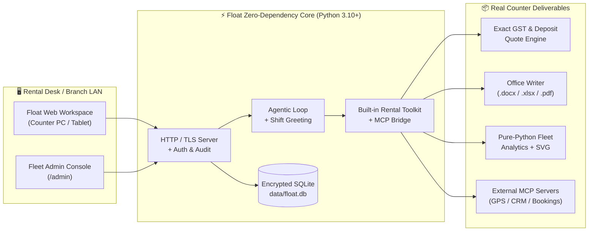

<div align="center">

# 🚘 Float

### **The AI Car Rental Operations & Fleet Command Center**

*Forty cars on the lot. Eight handovers a shift. One of you.*

[](https://www.python.org/)
[-059669?style=for-the-badge)](#⚡-60-second-quick-start)
[](#🔌-clean-mcp-model-context-protocol-support)
[](#🧪-testing--verification)
[](#🏢-branch-lan-server-mode-multi-operator)

<p align="center">
  <b>Instant GST Rental Quotes</b> • <b>Print-Ready Contracts (DOCX / PDF / XLSX)</b> • <b>Handover & Damage Checklists</b> • <b>Fleet Utilization Analytics</b> • <b>Multi-Desk LAN Server</b>
</p>

---

</div>

## ✨ Overview

**Float** is a fast, local-first AI operations workspace engineered for **car rental agencies, counter desk agents, dispatchers, and fleet managers**.

Stop juggling calculators, messy Word templates, WhatsApp rate cards, and scattered spreadsheets during peak handover hours. Float combines a **deterministic rental tariff & settlement engine** with **instant document generation** and **fleet analytics**—running 100% locally on standard Python with **zero external package installations**.

> [!TIP]
> **Built for Speed at the Counter:** Whether a customer is waiting at the airport pickup bay, asking for a 5-day outstation Innova quote on WhatsApp, or returning an SUV with extra kilometers and a scratched bumper, Float finishes the math and paperwork in seconds.

---

## 🎯 Six One-Click Counter Workflows

| Workflow | What Float Generates in Seconds | Output Formats |
| :--- | :--- | :--- |
| 🧾 **1. Instant Quote & Bill** | Itemized tariff calculation with base rent, included/extra km, extra hours, chauffeur allowance, tolls, fuel refill, 5%/18% GST (CGST + SGST), and refundable deposit balance + WhatsApp summary. | `Chat` · `.pdf` · `.docx` · `.xlsx` |
| 📄 **2. Rental Agreement** | Counter-ready Self-Drive or Chauffeur-Driven vehicle rental contract with KYC fields, odometer/fuel readings, deposit terms, liability clauses, and customer/operator signature blocks. | `.docx` · `.pdf` |
| 📋 **3. Handover & Return Sheet** | Side-by-side Outgoing vs. Incoming inspection checklist covering exterior panels, tyres, glass, interior, spare wheel, toolkit, FASTag balance, and fuel bars. | `.docx` · `.pdf` · `.xlsx` |
| 🔧 **4. Damage & Claim Notice** | Structured incident & damage assessment report with panel-by-panel repair estimates, workshop labour/paint breakdown, and security deposit deduction settlement. | `.docx` · `.pdf` |
| 💬 **5. Customer Comms** | Polished, ready-to-send WhatsApp, SMS, and email messages for booking confirmations, chauffeur details, payment links, extension approvals, and deposit refunds. | `WhatsApp` · `Email` · `SMS` |
| 📊 **6. Fleet & Revenue Analyzer** | Upload or paste any vehicle revenue sheet, trip log, or utilization table (`.csv`, `.xlsx`, `.pdf`, `.docx`) for pure-Python statistical analysis, top/bottom vehicle ranking, and SVG charts. | `SVG Charts` · `.xlsx` · `Report` |

---

## 🧠 Architecture & Agentic Flow



---

## 🛠️ Built-In Agentic Toolkit & MCP

Float's AI assistant never guesses arithmetic—it invokes deterministic local tools to compute bills, inspect fleet groups, and build real downloadable files:

| Tool | Purpose | Key Capabilities |
| :--- | :--- | :--- |
| `calculate_quote` | **Exact Tariff & Settlement Math** | Computes base daily/weekly/monthly rent, included vs. actual km, extra km & extra hour charges, chauffeur allowance, tolls/FASTag, fuel shortage, damage penalties, discounts, CGST/SGST, and net payable or refund due against security deposit. |
| `create_file` | **Native Document Writer** | Builds formatted **Word (`.docx`)**, **Excel (`.xlsx`)**, and **PDF (`.pdf`)** files directly onto your machine with zero third-party libraries. |
| `look_up_class` | **Fleet Group & Roster Lookup** | Retrieves registered vehicle groups, plate numbers, booking histories, and logged revenue/utilization metrics. |
| `save_task` | **Shift Ops Checklist** | Adds dated operational tasks (*Handover*, *Return*, *Maintenance*, *Billing*, *Renewal*, *Follow-up*) directly to the operator's shift queue. |
| `read_my_day` | **Live Shift Dispatch Schedule** | Reads today's upcoming vehicle pickups, returns, and open counter tasks to keep the desk ahead of schedule. |
| `use_computer` | **Operator-Confirmed Desktop Actions** | Optional local screen view and desktop automation (strictly restricted to the physical host machine with explicit operator confirmation). |
| `mcp__*` | **Model Context Protocol Tools** | Dynamically discovers and calls tools from any connected `stdio` or `http`/`sse` MCP server. |

---

## ⚡ 60-Second Quick Start

Float requires **only Python 3.10 or newer**. There is no `requirements.txt` and no `pip install` step.

### 🪟 Windows (One-Click Launchers)

| Launcher | What It Does |
| :--- | :--- |
| **`Start Float.bat`** / **`Start Float.vbs`** | Starts Float in single-counter mode with instant window launch (`http://127.0.0.1:8766`). |
| **`Start Float Agency Server.bat`** | Starts Float in **Branch LAN Agency Mode** (`0.0.0.0:8766`) so every fixed desk PC on branch LAN can sign in. |
| **`Stop Float.bat`** / **`Stop Float.vbs`** | Cleanly stops a running Float server in the background. |

### 🍎 macOS (MacBook & Mac One-Click Launchers)

| Launcher | What It Does |
| :--- | :--- |
| **`Float.app`** | Native macOS Application Bundle with Retina icon?double-click in Finder or drag to Dock for instant launch. |
| **`Start Float.command`** | One-click Finder script that clears Gatekeeper quarantine attributes and starts Float immediately. |
| **`Start Float Agency Server.command`** | Starts Float in **Branch LAN Agency Mode** (`0.0.0.0:8766`) on a central Mac server. |
| **`Stop Float.command`** | Cleanly stops a running Float server and displays a native macOS notification. |

### 💻 Terminal (Windows / macOS / Linux)

```bash
# 1. Clone the repository
git clone https://github.com/shivasharma12342012-commits/Float.git
cd Float

# 2. Start Float locally (opens http://127.0.0.1:8000)
python main.py
```

#### Useful CLI Commands

```bash
# Run as a multi-operator Branch LAN Server
python main.py --lan

# Check if Float is currently running and view its PID / port
python main.py status

# Gracefully stop a running Float server from the terminal
python main.py stop

# Reset an operator's password from the host machine
python main.py set-password operator@agency.local NewStrongPass123!

# Print environment & health diagnostics
python main.py doctor
```

---

## 🚘 Tailored for Car Rental Operations

<div align="center">

| 🏷️ Service Modes | 🚙 Fleet Categories | 🌐 13 Supported Languages |
| :--- | :--- | :--- |
| • Self-Drive Daily<br>• Chauffeur-Driven<br>• Corporate / B2B Fleet<br>• Airport & Hotel Transfer<br>• Long-Term Subscription<br>• Luxury & Wedding Fleet | • Hatchback & Compact Sedan<br>• Executive Sedan<br>• Compact SUV<br>• 7-Seater SUV / MUV<br>• Luxury Sedan & Luxury SUV<br>• Electric (EV)<br>• Tempo Traveller / Van / Minibus | • English (`en`) & हिन्दी (`hi`)<br>• বাংলা (`bn`) & मराठी (`mr`)<br>• தமிழ் (`ta`) & తెలుగు (`te`)<br>• ગુજરાતી (`gu`) & ಕನ್ನಡ (`kn`)<br>• മലയാളം (`ml`) & ਪੰਜਾਬੀ (`pa`)<br>• ଓଡ଼ିଆ (`or`), অসমীয়া (`as`), اردو (`ur`) |

</div>

---

## 🔌 Clean MCP (Model Context Protocol) Support

Connect external fleet databases, GPS telematics, CRM systems, or local filesystem tools directly into Float:

1. Click **MCP** in the top navigation bar.
2. Add a server using either:
   - **`stdio` transport** — e.g., `npx -y @modelcontextprotocol/server-filesystem C:\FleetDocs`
   - **`http` / `sse` transport** — e.g., `http://127.0.0.1:3001/mcp`
3. Toggle the server **Enabled** or click **Test** to inspect discovered tools in real time.
4. Enabled MCP tools are automatically injected into Float's agent loop with clear visual status badges.

---

## 🏢 Branch LAN Server Mode (Multi-Operator)

Running a rental branch with multiple counter agents and dispatchers? Start Float with `python main.py --lan`:

- **One Shared Agency API Key**: The Fleet Admin sets the AI key once in `/admin`. Desk operators sign in with their email/PIN and never see or manage raw API credentials.
- **Fair-Share Monthly Budgets**: Set an equal monthly token/rupee allowance per operator, with audited per-person overrides when needed.
- **Strict Workspace Isolation**: Operator A can never view, edit, or delete Operator B's chats, fleet groups, or generated files.
- **Full Security & Audit Trail**:
  - Passwords hashed with `scrypt` (`N=16384, r=8, p=1`).
  - API keys encrypted at rest using machine-bound AES-GCM / HMAC keys.
  - Exportable CSV audit logs and one-click SQLite database backups from `/admin`.

---

## 🤖 Supported AI Providers

Switch providers or models at any time from **Settings** (or branch-wide from **`/admin`**):

- **OpenRouter** *(Claude Sonnet/Haiku, GPT-4o, Gemini, Llama, DeepSeek)*
- **Anthropic** *(Claude Sonnet 4.5, Claude Haiku 4.5, Claude Opus 4.1)*
- **OpenAI** *(GPT-4.1, GPT-4.1 mini, GPT-4o, GPT-4o mini)*
- **Google Gemini** *(Gemini 2.5 Pro, Gemini 2.5 Flash, Gemini 2.0 Flash)*
- **Local Ollama / OpenAI-Compatible Endpoint** *(Run 100% offline on local hardware)*

---

## 📂 Project Structure

```text
Float/
├── main.py                        # CLI entry point (serve, --lan, stop, status, doctor, set-password)
├── Start Float.bat                # One-click Windows local desk launcher
├── Start Float Agency Server.bat  # One-click Windows branch LAN server launcher
├── Stop Float.bat                 # One-click Windows server stopper
├── float/
│   ├── agent.py                   # System prompt, car rental persona & streaming tool loop
│   ├── artifacts.py               # Zero-dependency .docx, .xlsx, and .pdf document writers
│   ├── attachments.py             # PDF, Word, Excel, and CSV text extraction for uploads
│   ├── computer.py                # Operator-confirmed local screen & desktop automation
│   ├── config.py                  # Providers, fleet categories, service modes & environment settings
│   ├── db.py                      # SQLite schema, encryption, fleet groups, tasks & audit log
│   ├── greeting.py                # Shift-aware operator greeting & upcoming pickup/return alerts
│   ├── mcp.py                     # Clean Model Context Protocol client (stdio & HTTP JSON-RPC)
│   ├── providers.py               # Streaming LLM adapters (Anthropic, OpenAI, Gemini, OpenRouter)
│   ├── security.py                # scrypt password hashing, rate limiting & at-rest secret encryption
│   ├── server.py                  # Threaded HTTP/TLS server, REST API & SSE streaming routes
│   ├── stats.py                   # Pure-Python fleet/revenue sheet statistics & analysis
│   ├── tools.py                   # Native rental quote engine, document builder & tool dispatcher
│   └── web/                       # Zero-build vanilla JS/CSS counter workspace & Admin UI
├── docs/
│   ├── DESIGN.md                  # Architecture & zero-dependency engineering notes
│   └── AGENCY_SERVER.md           # Branch LAN deployment & administration guide
└── tests/                         # 475 unit & integration tests
```

---

## 🧪 Testing & Verification

Run the complete 475-test suite (covering quote arithmetic, GST/deposit edge cases, document generation, XLSX parsing, MCP clients, LAN isolation, and server stop lifecycle) with warnings treated as errors:

```bash
python -W error -m unittest discover -s tests -p "*.py"
```

---

<div align="center">

**Built for Car Rental Desks & Fleet Operations Teams — Fast, Local-First, Zero Dependencies.**

</div>
